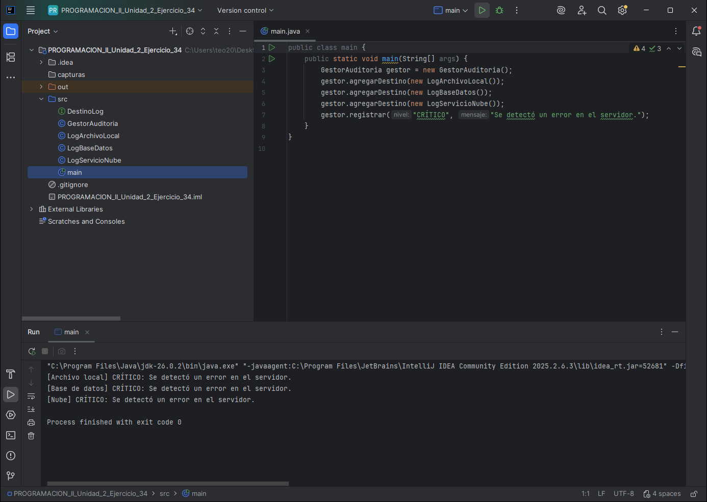

# PROGRAMACIÓN II — Unidad 2, Ejercicio 34: El Sistema de Exportación de Logs del Sistema

Trabajo práctico de Programación II. Este repositorio contiene la resolución en Java del ejercicio 34 de la Unidad 2.

## Consigna

#### Contexto

Los servidores de una empresa registran eventos operativos masivos (logs) que deben ser respaldados en distintos destinos de almacenamiento (archivos locales en disco, bases de datos relacionales o servicios de nube). La modularidad permite que el subsistema de auditoría delegue el almacenamiento a componentes especializados.

#### Consigna

Diseñar un modelo modular en Java donde un objeto central emita registros de eventos utilizando una interfaz genérica de exportación y persistencia de logs.

#### Desarrollo requerido

- Crear la interfaz DestinoLog con el método abstracto void guardarRegistro(String nivel, String mensaje).
- Implementar clases concretas como LogArchivoLocal, LogBaseDatos y LogServicioNube que implementen el contrato con sus protocolos de conexión particulares.
- Desarrollar una clase coordinadora GestorAuditoria que almacene una lista de destinos y permita difundir los mensajes de error o información de manera masiva.
- En el método main, instanciar el gestor, agregarle diversos destinos de respaldo y simular el envío de un registro crítico imprimiendo el reporte por consola.

## Estructura del repositorio

```
PROGRAMACION_II_Unidad_2_Ejercicio_34/
├── README.md
├── capturas/
│   └── consola.png
└── src/
    ├── DestinoLog.java
    ├── GestorAuditoria.java
    ├── LogArchivoLocal.java
    ├── LogBaseDatos.java
    ├── LogServicioNube.java
    └── main.java   # clase con el método main
```

## Funcionamiento y lógica

El ejercicio usa una **interfaz** para enviar un mismo registro de auditoría a varios destinos a la vez.

### `DestinoLog` (interfaz)

Define `void guardarRegistro(String nivel, String mensaje)`.

### `LogArchivoLocal`, `LogBaseDatos` y `LogServicioNube`

Implementan la interfaz y muestran el registro con una etiqueta que indica el destino: `[Archivo local]`, `[Base de datos]` o `[Nube]`.

### `GestorAuditoria`

Guarda una lista de destinos (`ArrayList<DestinoLog>`).

- **`agregarDestino()`:** suma un destino.
- **`registrar(nivel, mensaje)`:** recorre la lista y le pide a cada destino que guarde el registro.

### `main`

Crea el gestor, le agrega los tres destinos y registra un evento **CRÍTICO**: "Se detectó un error en el servidor". El mismo registro queda guardado en los tres destinos.

## Ejecución

Captura de la consola de IntelliJ IDEA ejecutando el programa:



Salida obtenida:

```
[Archivo local] CRÍTICO: Se detectó un error en el servidor.
[Base de datos] CRÍTICO: Se detectó un error en el servidor.
[Nube] CRÍTICO: Se detectó un error en el servidor.
```
